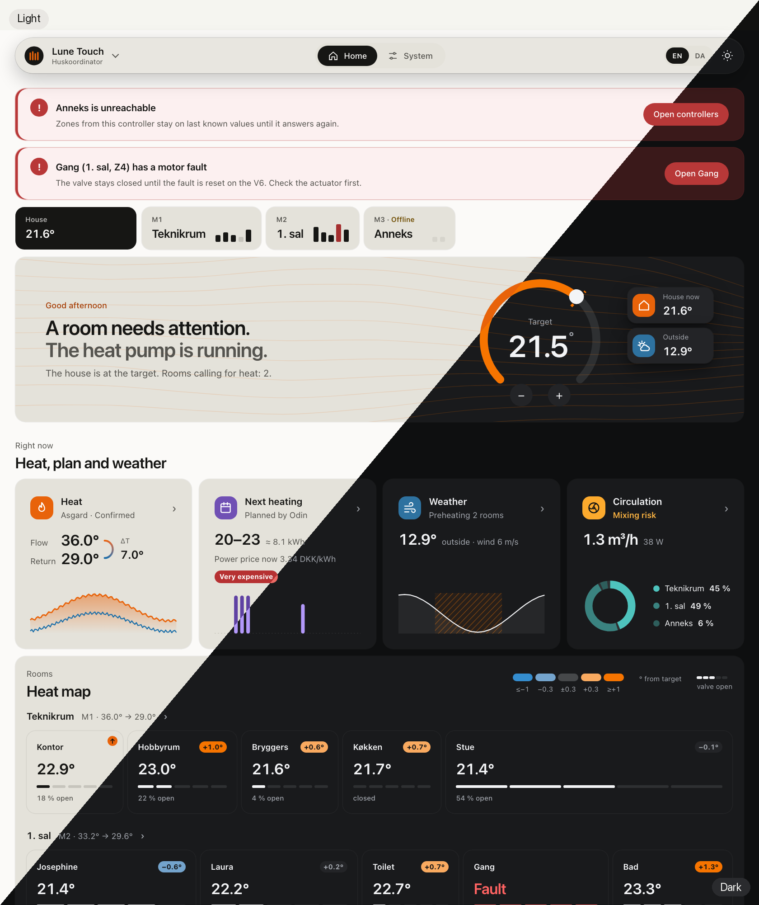

# Lune Touch / Mini

House coordinator for one or more [Lune V6](https://github.com/Birkemosen/lune)
manifold boards. **Lune Touch** is the 7-inch ESP32-S3 wall unit with LVGL and a
local web UI; **Lune Mini** is the same coordinator without a display.

**Documentation:** [docs/README.md](docs/README.md) — index of all Touch documentation, with links to Lune V6 and the design system.



## Integrates with

- **[Asgard](https://github.com/gekkekoe/esphome-ecodan-hp)** — ESPHome firmware and PCB
  for Mitsubishi Ecodan heat pumps. Touch sends the house temperature and comfort target to
  Asgard's virtual thermostat and reads the heat pump's flow, return, compressor and history.
  See [Asgard authority](docs/lune_asgard_authority_state_machine.md).
- **[Odin](https://github.com/gekkekoe/heatpump-optimizer)** — heat pump cost optimizer.
  Touch reads Odin's heating plan, can keep Odin's setpoint on the house target and push
  electricity prices to it. See [Odin plan ingestion](docs/odin_plan_ingestion.md).

Asgard and Odin are separate projects by their own authors; Lune is not affiliated with them.

## Firmware

Active entrypoints (standalone checkout):

```text
configurations/lune-touch-7.yaml        # Touch — Waveshare ESP32-S3-Touch-LCD-7B
configurations/lune-mini.yaml           # Mini — headless, ESP32-S3 N16R8
configurations/lune-mini-n8r8.yaml      # Mini — headless, ESP32-S3 N8R8
configurations/*-release.yaml           # the same, as public images without secrets
```

Shared stack: network/OTA/safe mode, USB serial provisioning, diagnostics,
`lune_touch_coordinator`, Touch API, and the embedded web UI. Touch adds LCD/LVGL;
Mini omits the display package. The board profile (`packages/board/`) sets flash,
PSRAM and partitions.

### Lune Touch

Waveshare ESP32-S3-Touch-LCD-7B, 1024×600 RGB565, GT911 touch, CH422G panel
power/reset. LCD timings and buffer rules live in `docs/LCD_STABILITY.md`; field
checks in `docs/field_validation.md`.

### Lune Mini

The same coordinator on a standard ESP32-S3 board without a display, set up and used
from the web UI and Home Assistant. It needs **octal PSRAM** (history, HTTP bodies
and TLS for the weather forecast live there):

| Module | Flash / PSRAM | Example board | Config | OTA slot / history |
|---|---|---|---|---|
| N16R8 | 16 MB / 8 MB octal | ESP32-S3-DevKitC-1-N16R8 | `lune-mini.yaml` | 6.4 MB / 3.4 MB |
| N8R8 | 8 MB / 8 MB octal | ESP32-S3-DevKitC-1-N8R8 | `lune-mini-n8r8.yaml` | 3 MB / 1.8 MB |

Modules with quad PSRAM (N8R2, N4R2) or none (N8, N16) are not supported. Mini is
about 1.7 MB.

First flash: write `lune-mini-n16r8-<version>.factory.bin` or
`lune-mini-n8r8-<version>.factory.bin` from the GitHub release at offset 0, e.g. with
[ESPHome Web](https://web.esphome.io) over USB. Then join the **Lune Mini Setup**
WiFi, pick your network in the captive portal and open the device in a browser.
Home Assistant sets the API encryption key when you add the device. Updates: the
`.ota.bin` from the release, uploaded from the web UI (System › Firmware).

### Building

```bash
make config
make build
make deploy HOST=192.168.x.x
make config-mini
make build-mini
make deploy-mini HOST=192.168.x.x
make build-mini-n8r8
make test
```

`make build` / `make deploy` append a development suffix (`v1.0.0-1`, …). Release
builds drop it:

```bash
make release
make release VERSION=v1.0.0
make release-deploy HOST=192.168.x.x
make release-mini
```

`make build-verify` compiles without touching `version.yaml`. Firmware is checked
against the board's OTA slot (0x640000, or 0x300000 for N8R8).

### Secrets and public images

Development builds of your own devices include `packages/network/build-secrets.yaml`:
the WiFi seed, the API encryption key and the OTA password from `secrets.yaml`. The
`configurations/*-release.yaml` entrypoints leave it out, so a published image
carries none of them. `make release-firmware` builds all three public images into
`dist/` (`<name>-<version>.factory.bin` and `.ota.bin`) after `make prepare-release`.

## Web UI

The on-device web UI (Home / sheets / System) is built on the **Lune design system** — tokens and components in
`web/design-system/`, pages and i18n in `web/touch-ui/`. Firmware serves the gzip
bundle from `packages/dashboard/` (`/`, `/en/`, `/da/`, plus `/api/lune-touch/v1/*`).

```bash
make touch-ui
# open web/_preview.html or web/touch-ui/dist/preview-en.html
```

Design changes land first in the sibling
[`lune-design-system`](https://github.com/Birkemosen/lune-design-system) repo,
then sync into `web/design-system/`. Agent rules: `AGENTS.md` and
`web/design-system/DESIGN.md`.

## Wall display (LVGL)

Touch UI screens, theme, and mockups are documented under `docs/display/`.
LVGL theme, C++ colour constants and brand marks come from the sibling
[`lune-design-system`](https://github.com/Birkemosen/lune-design-system) repo
(`display` in `tokens/tokens.json`, generated by `tools/lds_display.py`):

```bash
# clone ../lune-design-system next to this repo
make design-tokens
make design-verify
```

## Ownership boundary

**Coordinator-owned:** weather fetch/cache; wind/solar/thermal-lead model;
house-wide preload across V6 nodes; adaptive learning and zone priority; comfort
bias folded into strategy before V6 commands; persisted per-zone learning
signals; command ledger (source, reason, requested/accepted value, expiry, clamp).

**Lune V6-owned:** motors and endstops; local temperature freshness; conservative
control without a coordinator; minimum flow; command validation/clamp/expiry;
snapshot/diagnostics API.

See also `docs/lune_brand_architecture.md`, `docs/api_v1.md`, and
`docs/forecast_preload.md`.

## Bringup note

Pinout and panel bring-up are settled. Treat changes to LCD timings, LVGL
buffers, HTTPS forecast behavior, dashboard bundle size, or poll cadence as
field-sensitive — re-run `docs/field_validation.md` before trusting a flashed
build.

## License

[GPL-3.0-or-later](LICENSE). The firmware is built on ESPHome, whose runtime is GPLv3;
`components/rpi_dpi_rgb/` is a local override derived from ESPHome's own component.
Third-party files keep their own licenses.

"Lune" and "Lune Touch" identify this project. Forks must use a different name and must
not be presented as Lune or as endorsed by this project.

## Support the project

Lune is developed in spare time and paid for out of pocket. If it heats your home and you
want to give something back, you can sponsor it through
[GitHub Sponsors](https://github.com/sponsors/Birkemosen).

If you use Lune Touch, a small one-time thank-you is welcome but never expected.
Sponsoring comes with no rewards or promises: Lune is built at its own pace.
